# Pipeline Architecture

A rendered PNG version is at [`architecture_diagram.png`](architecture_diagram.png)
(regenerate with `python scripts/generate_architecture_diagram.py`).

## Stage flow

```mermaid
flowchart LR
    A[Data Ingestion<br/>MovieLens 100K / synthetic<br/>→ data/raw] --> B[Data Validation<br/>6 checks + error quarantine<br/>→ data/errors]
    B --> C[Data Preparation<br/>clean · standardize<br/>time-based split → data/processed]
    C --> D[Data Transformation<br/>activity summary · item popularity<br/>user-item matrix]
    D --> E[Feature Management<br/>user/item/interaction features<br/>+ catalog → data/features]
    E --> F[Model Training<br/>Popularity + Matrix Factorization<br/>MLflow tracking]
    F --> G[Model Evaluation<br/>P@K · R@K · NDCG · Coverage<br/>Diversity · RMSE/MAE]

    subgraph ORCH [Orchestration]
        direction LR
        P[pipeline.py runner] -.-> AF[Airflow DAG]
    end
    ORCH -.orchestrates.-> A
    G -.metrics.-> ML[(MLflow)]
    F -.params/artifacts.-> ML
```



## Data layout

```
data/
├── raw/          users.csv, items.csv, interactions.csv  (+ *_valid.csv)
├── errors/       quarantined invalid records + validation_report.json
├── processed/    train/test split, user-item matrix, derived datasets
└── features/     user_features, item_features, interaction_features, feature_catalog
```

## Design principles

1. **Modular** — every stage is an importable module with a `run(config_path)`
   entry point and can be executed standalone or via the orchestrator.
2. **Config-driven** — all parameters live in `configs/config.yaml`; a single
   `seed` makes the whole run reproducible.
3. **No leakage** — all features and derived datasets are built from the
   **training** interactions only; the time-based split keeps the test period
   strictly in the future.
4. **Fail-fast orchestration** — the runner executes stages in topological order
   and halts on the first failure, writing a run summary either way.
5. **Portable** — the personalized model is NumPy-only (no native build deps),
   and ingestion falls back to synthetic data if the download is unavailable.
