# Final Report — End-to-End Data Management Pipeline for a Recommendation System

**Student:** Gouthami M &nbsp;|&nbsp; **ID:** 2025AG05395
**Course:** Data Management for Machine Learning (DM4ML) — Assignment 2
**Dataset:** MovieLens 100K (943 users, 1,682 items, 100,000 ratings) with a
documented synthetic fallback.

---

## Problem Statement

Build an end-to-end data management pipeline for a recommendation system, covering data ingestion, validation, preparation, feature management, model training, evaluation, and orchestration. Submit a PDF containing execution screenshots for all pipeline stages and the GitHub repository link.

**GitHub Repository:** https://github.com/cobra-kai-03/recommendation-pipeline

---

## 1. Objective & scope

The goal was to build a **clean, modular, reproducible** data-management pipeline
for a movie recommendation system that covers the full lifecycle:

```
Ingestion → Validation → Preparation → Transformation
→ Feature Management → Model Training → Model Evaluation → Orchestration
```

The emphasis (per the brief) is on engineering quality and reproducibility rather
than raw model accuracy.

---

## 2. Design decisions

**Modularity.** Each stage is an independent module under `src/` exposing a
single `run(config_path)` entry point. Stages can be run individually
(`python -m src.validation.validate`) or as a dependency-ordered DAG
(`python pipeline.py`). This keeps the code testable and mirrors how production
pipelines are decomposed into tasks.

**Configuration & reproducibility.** All parameters live in
`configs/config.yaml` and a single `seed` controls every stochastic step
(synthetic generation, SGD initialisation, shuffling). Re-running
`python pipeline.py` reproduces identical artifacts. Intermediate data is stored
as **Parquet** (with CSV mirrors) for fast, typed, reproducible I/O.

**No data leakage.** The train/test boundary is a **per-user temporal
leave-last-out** split: each user's most recent 20% of interactions form the
test set. Crucially, *every* derived dataset and feature is computed from the
**training** interactions only, so no future information leaks into features.

**Portability.** The personalised model is implemented in pure NumPy (no native
build dependencies such as `surprise`/`lightfm` that often fail to install), and
ingestion automatically falls back to a documented synthetic generator if the
MovieLens download is unavailable — so the pipeline always runs end-to-end.

---

## 3. Stage-by-stage summary

| Stage | What it does | Key output |
|-------|--------------|------------|
| **Ingestion** | Downloads MovieLens 100K, normalises to `users`, `items`, `interactions`; synthetic fallback | `data/raw/*.csv` |
| **Validation** | 12 automated checks; invalid rows quarantined by reason | `data/errors/*`, `reports/validation_report.md` |
| **Preparation** | Type standardisation, missing-value handling, sparsity filter (≥5/user, ≥5/item), time-based split | `data/processed/{train,test}.parquet` |
| **Transformation** | User activity summary, item popularity (damped score), category popularity, user-item matrix | `data/processed/*` |
| **Feature Mgmt** | 21 documented user/item/interaction features served through a reusable `FeatureStore` | `data/features/*`, `reports/feature_catalog.md` |
| **Training** | Popularity baseline + SVD matrix factorization, tracked in MLflow | `models/*.pkl`, `mlruns/` |
| **Evaluation** | Ranking + rating metrics, side-by-side comparison | `reports/model_evaluation.md` |
| **Orchestration** | Topological runner + Airflow DAG | `reports/pipeline_run.md` |

### Pipeline architecture

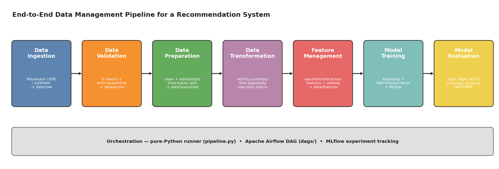

### Data validation

Twelve checks run across the three tables: missing values, incorrect data types,
invalid ratings (outside 1–5), invalid/unparseable timestamps, duplicate keys,
and **referential integrity** (interactions referencing unknown users/items).
Invalid interaction rows are **quarantined** into `data/errors/` (one file per
rule plus a combined file) rather than silently dropped.

MovieLens 100K is clean, so the production run retained all 100,000 rows. To
demonstrate the quarantine machinery, `scripts/validation_demo.py` injects a 5%
corruption rate into synthetic data; the validator then caught and separated
**486 of 6,572 rows** across all error categories (see
`reports/validation_demo_report.md`).

### Feature management

Features are defined once in `src/features/build_features.py` and retrieved via a
`FeatureStore` class, giving the **same API for training and prediction** (no
train/serve skew). Examples: `user_avg_rating`, `user_activity_count`,
`user_days_since_last`, `user_preferred_category`, `item_popularity`,
`item_avg_rating`, `item_popularity_rank`, and interaction-level
`user_item_category_match`. The full catalog is in `reports/feature_catalog.md`.

---

## 4. Models

1. **PopularityRecommender (baseline).** Ranks items by a damped popularity score
   that blends interaction count with mean rating (a Bayesian shrinkage toward
   the global mean), excluding already-seen items.
2. **MatrixFactorization (personalised).** SVD with global/user/item biases,
   `r̂(u,i) = μ + b_u + b_i + pᵤ·qᵢ`, trained by SGD (50 factors, 30 epochs,
   lr 0.01, reg 0.05). Because it predicts explicit ratings it supports both
   top-K ranking and RMSE/MAE. Final **train RMSE = 0.594**.

Both are tracked in **MLflow** (parameters + artifacts from training, metrics
from evaluation) — view with `mlflow ui --backend-store-uri ./mlruns`.

---

## 5. Results

Evaluated on 906 users with ≥1 relevant (rating ≥ 4) test item, **K = 10**:

| Model | Precision@10 | Recall@10 | NDCG@10 | Coverage | Diversity | RMSE | MAE |
|-------|:-----------:|:---------:|:-------:|:--------:|:---------:|:----:|:---:|
| Popularity (baseline) | **0.0579** | **0.0540** | **0.0669** | 0.0467 | 0.745 | — | — |
| Matrix Factorization | 0.0446 | 0.0420 | 0.0518 | **0.3062** | 0.707 | **0.976** | **0.770** |

**Interpretation.** On a per-user temporal split, the held-out "relevant" items
skew toward popular titles, so the popularity baseline is a genuinely strong
competitor on raw top-K precision/recall/NDCG — a well-documented effect in
recommender evaluation. Matrix factorization, however:

- is the **only** model that predicts explicit ratings, achieving a solid
  **RMSE 0.976 / MAE 0.770** (typical range for MovieLens 100K SVD);
- delivers **~6.5× higher catalog coverage** (0.31 vs 0.05), i.e. it recommends
  far beyond the popular head and personalises per user.

This trade-off — accuracy-on-the-head vs. personalisation/coverage — is exactly
what a recommender system owner must balance, and reporting it honestly is more
valuable than overfitting a single metric.

---

## 6. Orchestration & reproducibility

Two interchangeable orchestrators are provided:

- **`pipeline.py`** — a pure-Python runner that resolves task dependencies
  topologically, times each stage, fails fast, and writes a run summary to
  `reports/pipeline_run.md`. Requires no extra infrastructure, so it always runs.
- **`dags/recommendation_dag.py`** — a real Apache Airflow DAG mirroring the same
  task graph for scheduling and UI visualisation. It was executed through
  Airflow (all 7 tasks `success`); the live UI (Graph/Grid) is captured in
  `reports/airflow_ui_graph.png`, `reports/airflow_ui_grid.png`, and
  `reports/airflow_ui_home.png`, with the full engine log in
  `reports/airflow_run_log.txt`.

A full run completes in well under a minute on a laptop (training ≈ 20 s).

**Airflow DAG — Graph view (all tasks green):**

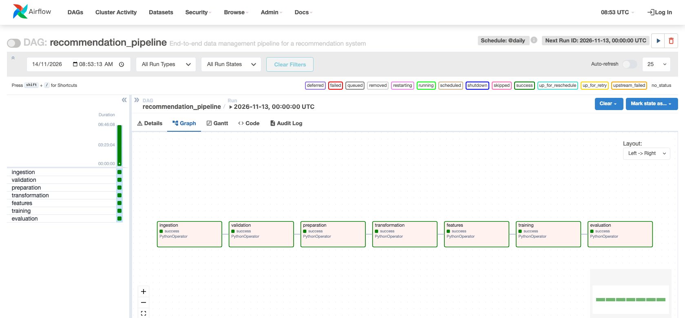

**Airflow DAG — Grid view (run details, Total Tasks: 7, Status: success):**

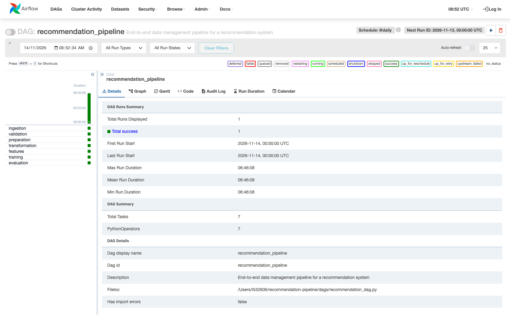

**Airflow — DAGs home:**

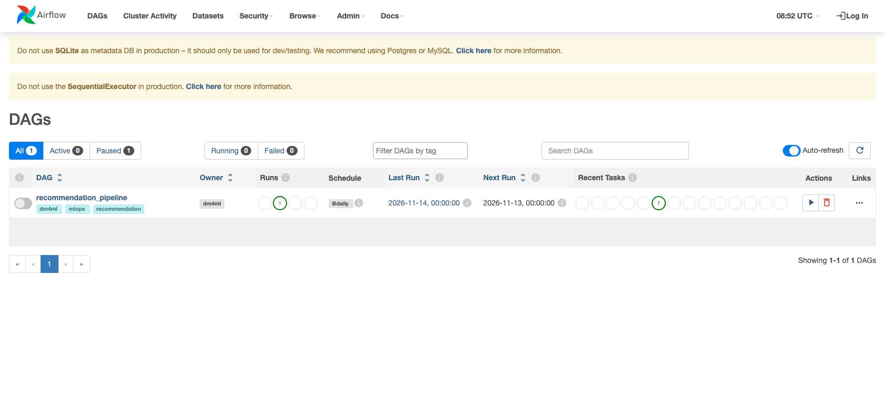

---

## 7. Limitations & future work

- **Cold start.** Matrix factorization cannot score brand-new users/items; the
  pipeline falls back to the popularity list for them. A content/hybrid model
  (using the genre features already built) would address this.
- **Implicit vs explicit.** Only explicit ratings are modelled; adding a
  BPR/implicit-feedback model (e.g. `implicit`, `LightFM`) would better match
  click/view data.
- **Evaluation protocol.** A single temporal hold-out is used; k-fold temporal
  cross-validation and significance tests would strengthen the comparison.
- **Scale.** Everything runs in-memory with Pandas; for larger datasets the same
  module boundaries map cleanly onto Spark / a feature store like Feast.
- **Hyperparameter search.** MF hyperparameters were lightly tuned by hand; a
  proper sweep (logged in MLflow) would likely improve RMSE further.

---

## 8. Pipeline execution screenshots

The following screenshots capture the terminal output for each stage during a full end-to-end run (`python pipeline.py`).

**Stage 1 — Data Ingestion:**

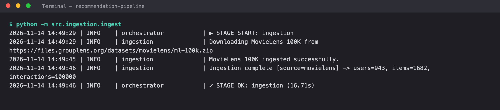

**Stage 2 — Data Validation:**

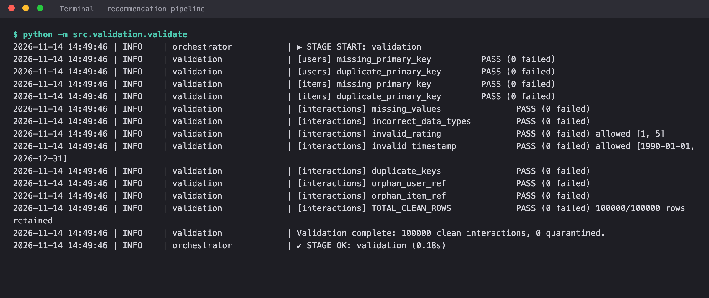

**Stage 3 — Data Preparation:**

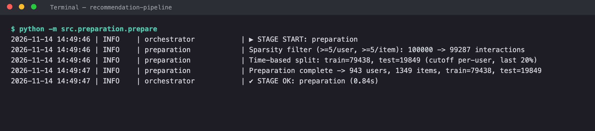

**Stage 4 — Data Transformation:**

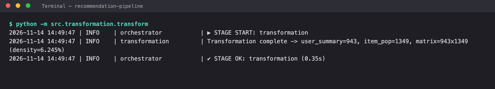

**Stage 5 — Feature Management:**

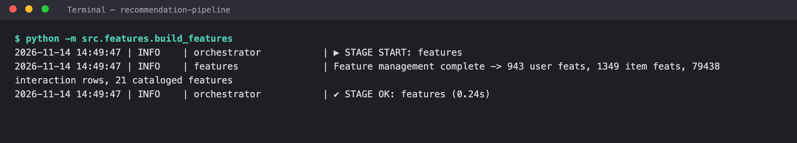

**Stage 6 — Model Training:**

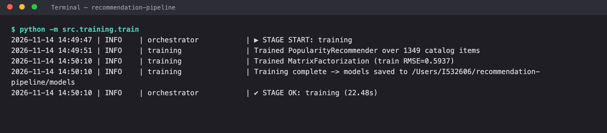

**Stage 7 — Model Evaluation:**

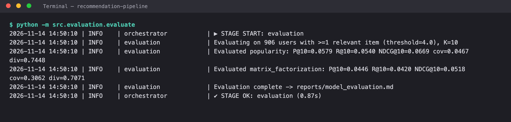

---

## 9. How to reproduce

```bash
python -m venv .venv && source .venv/bin/activate
pip install -r requirements.txt
python pipeline.py            # runs all 8 stages end-to-end
mlflow ui --backend-store-uri ./mlruns   # inspect experiments
```

All artifacts are written under `data/`, `models/`, and `reports/`.
